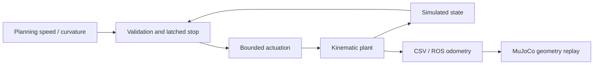

# Architecture and model assumptions

Planning sends desired forward speed and path curvature. The controller validates the
reference and state, chooses nominal or latched stopping mode, and emits acceleration
(m/s²) and front road-wheel angle (rad). The predictor advances the tractor rear axle
and on-axle-hitched trailer. The ROS adapter and standalone scenarios use the same core.

Tractor wheelbase is 3.8 m; hitch-to-trailer-axle distance is 8 m. World coordinates use
x/y, counterclockwise yaw, radians, meters, and seconds. The on-axle hitch is an intentional
simplification. The equations are:

- x_dot = v cos(tractor_yaw), y_dot = v sin(tractor_yaw)
- tractor_yaw_dot = v tan(steering) / 3.8
- trailer_yaw_dot = v sin(tractor_yaw - trailer_yaw) / 8
- speed_dot = acceleration, limited to nonnegative speed

Each step integrates distance exactly for constant acceleration up to standstill and
uses the previous headings for pose integration. This is a first-order turning model.
It omits tire slip, suspension, load transfer, aerodynamic drag, grade, actuator delay,
brake thermal effects, and off-axle hitch geometry. The numerical state validity ceiling
is 45 m/s; planner references are restricted to 0–35 m/s and |curvature| <= 0.05 1/m.

## Initial stability argument

For constant target speed with ideal acceleration and no saturation, the error obeys
`e[k+1] = (1 - 0.8 dt) e[k]`. With `0 < dt <= 0.1`, the pole is in `[0.92, 1)`, so this
scalar error converges. This argument does not include delay, saturation, or real brakes.

For straight forward driving, small articulation beta satisfies approximately
`beta_dot = -(v / 8) beta` with zero steering. It is locally stable for v > 0 and neutral
at standstill. This is not a proof for high-speed tire dynamics, reverse operation, or
arbitrary curved paths. Curvature feedforward is not lateral path-error feedback.

## Fault semantics and limitations

Input faults latch stopping mode until controller construction/restart. The core requests
-3 m/s² and holds the last valid steering. This is a deterministic simulation policy;
stopping on a curved highway may require a different verified fallback path. Brake hold
at standstill and conversion to brake pressure belong in a future actuator layer.

Steering target combines a 0.45 rad bound and a nominal 2 m/s² lateral-acceleration
bound, then applies a 0.3 rad/s rate limit. During rapid speed changes, the rate limit can
prevent immediate compliance with the lateral target. It is not a hard instantaneous
lateral acceleration guarantee. Add a speed/steering feasibility supervisor later.

The ROS adapter measures local command age and actual callback period with a steady
clock. It exits on an invalid plant integration interval rather than hiding a timing
failure. Shutdown here only stops a software simulation. A real actuation system needs
an independent watchdog, feedback, redundant stop paths, and power-loss behavior.

## Interfaces to develop

Planning: timestamped trajectories, validity horizon, frame, sequence and curvature limits.
Hardware: steering position/rate, brake pressure, wheel speed, protocol units and timeouts.
Systems: operational domain, hazard analysis, fault tolerance and quantitative acceptance limits.
Infrastructure: deterministic replay, CI artifacts, dependency provenance, calibration versions.
Embedded: fixed-size buffers, monotonic clock abstraction, transport boundary, explicit scheduler.
